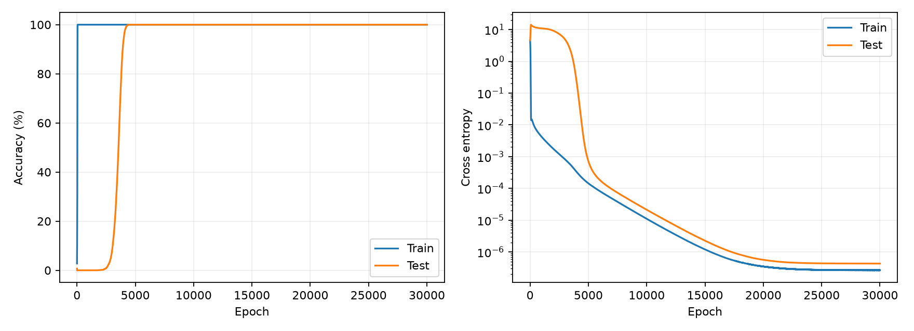
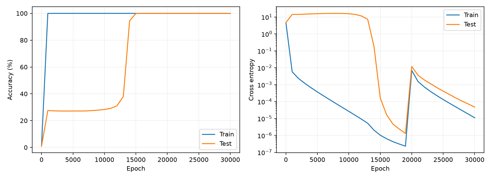
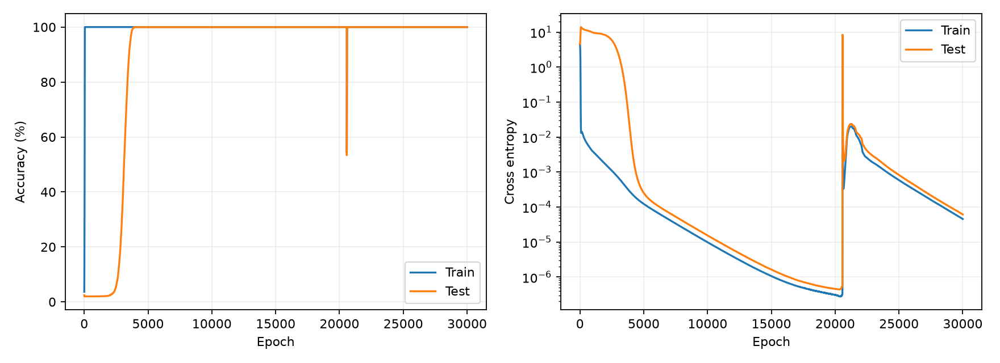
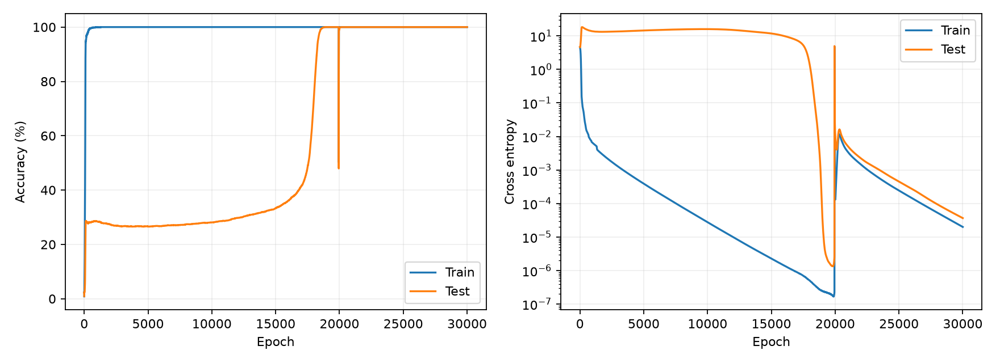

# grokking-experiment

模 97 加法与乘法的 Grokking 实验：用 MLP 和单层因果 Transformer，观察训练集拟合之后延迟出现的测试集泛化。

本仓库收录两种任务、四组 seed=42 的既有实验结果、数据生成与训练代码、原始历史曲线，以及最终模型的推理权重。所有指标来自保存的文件；最终准确率已重新加载模型在 CPU 上核验。

## 实验设置

| 项目 | 设置 |
| --- | --- |
| 加法 | `(a + b) % 97` |
| 乘法 | `(a * b) % 97`，包含零操作数 |
| 输入 | 两个整数，`a,b ∈ {0,...,96}` |
| 样本 | 全部 9409 个有序数对，互不重复 |
| 划分 | 训练 2822，测试 6587；随机排列，split seed=2026 |
| 训练 | full batch，每 epoch 一次更新，30000 epochs |
| 优化器 | AdamW，learning rate=0.001，weight decay=1.0 |
| 损失 | 97 类交叉熵 |
| 模型随机种子 | 42 |

MLP：128 维 token embedding，拼接后进入 `256 → 512 → 512 → 97`，隐藏层 GELU，共 456417 个参数。

Transformer：输入 `[a,b,=]`，128 维 embedding、可学习位置编码、4 个注意力头、单个因果注意力块，FFN 维度 512，残差连接，无 LayerNorm，输出末位置的 97 类 logits，共 223201 个参数。

## 保存的结果

| 任务 | 模型 | 首次记录到测试准确率 ≥95% 的 epoch | 最终训练准确率 | 最终测试准确率 | 历史记录数 |
| --- | --- | ---: | ---: | ---: | ---: |
| 加法 | MLP | 4024 | 100% | 100% | 30000 |
| 加法 | Transformer | 15000* | 100% | 100% | 31* |
| 乘法 | MLP | 3609 | 100% | 100% | 30000 |
| 乘法 | Transformer | 18314 | 100% | 100% | 30000 |

四个最终模型均重新核验为训练集 **2822/2822**、测试集 **6587/6587** 正确，核验结果见 [verification.json](verification.json)。

*加法 Transformer 的既有 CSV 只保留 epoch 1 和每 1000 epoch 的记录，因此 15000 是首次观测到达标的记录点，不能据此确定逐轮跨越时间。其曲线是这些记录点之间的连线。其他三组 CSV 包含每个 epoch 的记录。当前发布的训练脚本每轮记录指标，每 1000 轮打印；它不能补回旧实验未保存的数据。

### 加法 · MLP



### 加法 · Transformer



### 乘法 · MLP



### 乘法 · Transformer



左图为准确率，右图为交叉熵（对数纵轴）。保留原图与损失尖峰，未平滑或删除异常点。部分实验在约 20000 epoch 附近出现尖峰，现有记录不足以判断原因，不应据此推断具体机制。

## 运行

需要 Python 3.10 或更高版本。先安装依赖；PyTorch 的 GPU 版本需与自己的驱动环境匹配，CPU 也可以运行。

```bash
pip install -r requirements.txt
```

在仓库根目录启动加法实验：

```bash
cd addition
python data.py
python mlp.py --out ../reruns/addition
python transformer.py --out ../reruns/addition
cd ..
```

乘法实验：

```bash
cd multiplication
python data.py
python mlp.py --out ../reruns/multiplication
python transformer.py --out ../reruns/multiplication
cd ..
```

默认设置已写在代码里。也可以在 IDLE 中打开对应任务目录的 `mlp.py` 或 `transformer.py`，按 F5；确保运行工作目录为相应任务目录。默认输出会写入该目录的 `results`，重复运行会覆盖同名结果；保留仓库中的既有实验时，请使用上面指定不同 `--out` 的命令。

参数示例：

```bash
python mlp.py --epochs 30000 --lr 0.001 --weight-decay 1.0 --seeds 42 --log-every 1000 --save-every 1000 --device auto --out ../reruns/addition
```

每 1000 epoch 打印训练/测试损失、准确率与累计秒数，同时保存 checkpoint；每个 epoch 的指标用于最终 CSV 和图像。历史 CSV 与曲线在整个训练结束后写入，因此中途终止可能只有 checkpoint、没有完整 CSV。

## 核验已有模型

在仓库根目录运行，无需训练，也不需要 GPU：

```bash
python verify_results.py
```

脚本检查数据标签、无重复与无划分交叉、固定种子对应的数对顺序、历史记录、95% 阈值统计、最终模型损失与准确率，并写出 `verification.json`。不同设备的浮点损失可能有微小差异。

每组 `results/<model>/seed_42/` 中包含：

- `history.csv`：已有实验保存的记录；准确率单位是百分比。
- `curves.png`：原始训练/测试准确率与损失曲线。
- `epoch_30000.pt`：从原始最终 checkpoint 导出的推理权重及 epoch、seed、metrics，可用 `torch.load(..., weights_only=True)` 加载；不含优化器和随机数状态。

`results/<model>/summary.csv` 为原始摘要。中间 checkpoint 未收录；原始训练脚本运行时仍会保存它们。

## 解释边界

这些曲线展示了训练集较早拟合、测试集在更晚训练阶段明显改善的现象。它们是单个模型种子、单个固定数据划分的探索性复现，不能代表多随机种子统计结论。这里的泛化限定为同一模数下未参加训练的数对，不是外推到新模数。

测试集被用于逐轮监测及统计阈值，本实验未另设验证集或锁定的最终盲测集。历史训练的硬件、软件版本未完整归档，摘要中的耗时仅作为原始记录，不能用于公平比较 GPU 或模型速度。当前核验环境见 `verification.json`，该环境不代表原始训练环境。代码与固定种子有助于复现，但不保证跨设备、版本逐位一致。
